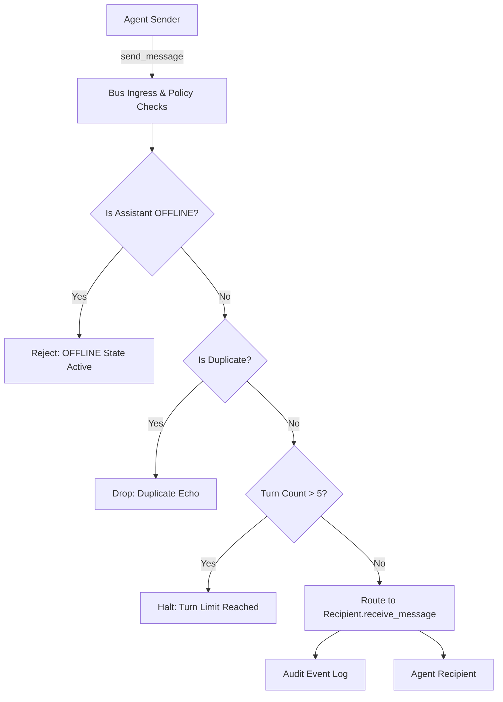

# Agent Communication Protocol & Message Bus Specification

**Protocol Version:** 1.0 (Phase 3 Baseline)  
**Encoding:** Typed Python dataclasses & JSON serialization  
**Communication Paradigm:** In-memory, asynchronous, bounded Message Bus

---

## 1. Message Data Schema

Every inter-agent exchange is encapsulated in a strongly typed `AgentMessage`:

```python
from enum import Enum
from dataclasses import dataclass, field
from typing import Optional, Dict, Any
import time
import uuid

class AgentId(str, Enum):
    MISS_MINUTES = "MISS_MINUTES"
    JARVIS = "JARVIS"
    USER = "USER"

class MessageType(str, Enum):
    CHAT = "CHAT"                      # Conversational dialogue
    DELEGATION = "DELEGATION"          # Task assignment to peer
    RESULT = "RESULT"                  # Task outcome or computed response
    QUESTION = "QUESTION"              # Clarifying query
    ACKNOWLEDGEMENT = "ACKNOWLEDGEMENT"# Receipt confirmation
    NOTIFICATION = "NOTIFICATION"      # Status update
    ERROR = "ERROR"                    # Failure notification
    CANCEL = "CANCEL"                  # Immediate conversation termination

class Priority(str, Enum):
    LOW = "LOW"
    NORMAL = "NORMAL"
    HIGH = "HIGH"
    URGENT = "URGENT"

@dataclass(frozen=True)
class AgentMessage:
    message_id: str = field(default_factory=lambda: str(uuid.uuid4()))
    conversation_id: str = field(default_factory=lambda: str(uuid.uuid4()))
    sender: AgentId
    recipient: AgentId
    message_type: MessageType
    content: str
    metadata: Dict[str, Any] = field(default_factory=dict)
    priority: Priority = Priority.NORMAL
    requires_response: bool = False
    parent_message_id: Optional[str] = None
    timestamp: float = field(default_factory=time.time)
```

---

## 2. Message Bus Architecture (`AgentMessageBus`)

The `AgentMessageBus` acts as the authoritative clearinghouse and policy enforcer for all agent communications:



### 2.1 Routing Rules
1. **Direct Point-to-Point:** Messages from `MISS_MINUTES` addressed to `JARVIS` are dispatched directly to `JarvisAgent.receive_message()`, and vice versa.
2. **Synchronous or Event-Driven:** The bus supports both direct request-response dispatch (`dispatch_and_wait`) and asynchronous queued publishing.
3. **Loop Detection & Turn Limits:**
   - Each conversation tracks `turn_count`.
   - If `turn_count > max_turns` (default: 5), the bus halts routing, logs a warning, and emits an `ERROR` or termination notice to prevent infinite AI banter.
4. **Duplicate Protection:**
   - Consecutive messages with identical `content` and `message_type` from the same sender in the same conversation are dropped.
5. **Cancellation:**
   - Calling `cancel_conversation(conversation_id)` marks the thread cancelled, causing any in-flight messages to be dropped immediately.

---

## 3. Shared Bounded Context (`SharedBoundedContext`)

To give both agents a coherent memory of current tasks without risking unbounded memory growth or credential leakage:

- **Bounded Turn Window:** Maintains a ring buffer of the last **10 turns** (5 exchanges).
- **Sanitized Contents:**
  - Automatic regex stripping of potential API keys (`sk-...`, `AIza...`, `gsk_...`).
  - No storage of passwords or tokens.
- **Thread Safety:** All reads and writes are protected by a threading `Lock`.

---

## 4. Observability & Logging

Inter-agent communication is recorded in an in-memory or development-only event log (`agents/audit_log.py`) in clean readable format:

```text
[20:30:15] [DELEGATION] MISS_MINUTES -> JARVIS (Conv: 8f3b2e)
Content: "Analyze query for YouTube lo-fi search"

[20:30:16] [RESULT] JARVIS -> MISS_MINUTES (Conv: 8f3b2e)
Content: "Prepared query URL: https://www.youtube.com/results?search_query=lo-fi+beats"
```
No private system files or user secrets are ever written to the communication log.
