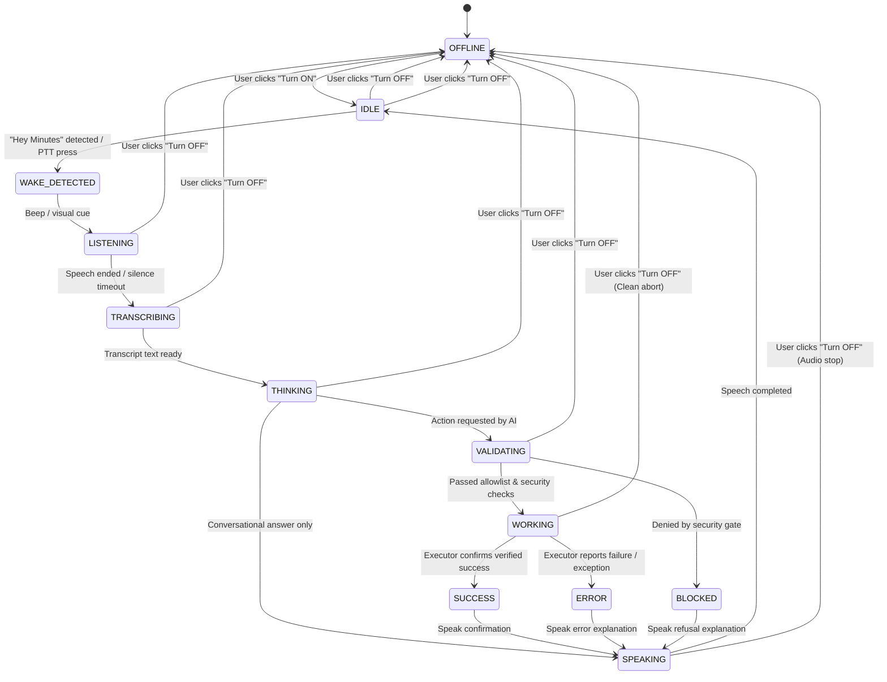

# Miss Minutes: System Architecture & Design Specification

**Status:** Phase 0 Architecture Blueprint  
**Target Platform:** Windows 10/11 (64-bit)  
**Implementation Stack:** Python 3.11–3.14 + PySide6 (Qt for Python)  
**Security Boundary:** Air-gapped AI intent vs. OS Execution with Strict Allowlist

---

## 1. High-Level Component Architecture

Miss Minutes is designed as a decoupled, multi-threaded native Windows desktop application. The system strictly separates visual rendering, audio/speech processing, AI reasoning, and operating system execution.

```mermaid
graph TD
    subgraph UI_Thread ["UI Thread (PySide6 Event Loop)"]
        Overlay["Transparent Floating Character Overlay"]
        Controller["Compact Control Panel (ON/OFF, Status, Settings)"]
        StateMachine["Assistant State Machine (12 States)"]
        Tray["System Tray Integration"]
    end

    subgraph Audio_Worker ["Audio & Voice Subsystem (Background Worker)"]
        MicCapture["Microphone Capture (WASAPI / PortAudio)"]
        WakeDetector["Wake Engine ('Hey Minutes' / Push-to-Talk)"]
        STTEngine["STT Provider (English, Telugu, Mixed)"]
        TTSEngine["TTS Provider (Async, Non-blocking Audio Stream)"]
    end

    subgraph AI_Subsystem ["AI Provider Subsystem"]
        ProviderRouter["AI Provider Router & Cooldown Engine"]
        GeminiAdapter["GeminiProvider (Preferred)"]
        GroqAdapter["GroqProvider (Fallback)"]
        IntentExtractor["Structured Intent & Response Parser"]
    end

    subgraph Security_Gate ["Security & Validation Layer (Non-Negotiable Boundary)"]
        TypedRequest["Typed ActionRequest Schema"]
        AllowlistValidator["Independent Security Validator & Policy Gate"]
        ConfirmationUI["User Confirmation Flow (UI Modal)"]
        AuditLogger["Privacy-Preserving Audit Logger"]
    end

    subgraph OS_Executors ["Windows-Safe Executors"]
        DateTimeExec["Local Date/Time Provider"]
        SafeUrlExec["Validated Browser Opener (Default Browser)"]
        AppLaunchExec["Allowlisted Windows App Launcher (Start Menu/Known Paths)"]
        WinAudioExec["Windows Media / Volume Controller (PyCaw / CoreAudio)"]
    end

    %% Flow connections
    Controller -->|Manual ON/OFF Toggle| StateMachine
    StateMachine -->|Signal State Change| Overlay
    StateMachine -->|Enable / Disable Signals| MicCapture
    MicCapture -->|Audio Chunks| WakeDetector
    WakeDetector -->|Wake Event| StateMachine
    MicCapture -->|User Utterance| STTEngine
    STTEngine -->|Transcript Text| StateMachine
    StateMachine -->|Send Utterance| ProviderRouter
    ProviderRouter --> GeminiAdapter
    ProviderRouter --> GroqAdapter
    GeminiAdapter --> IntentExtractor
    GroqAdapter --> IntentExtractor
    IntentExtractor -->|Raw Action Dict / Conversational Text| TypedRequest
    TypedRequest --> AllowlistValidator
    AllowlistValidator -->|Requires User Confirmation| ConfirmationUI
    ConfirmationUI -->|Confirmed| AllowlistValidator
    AllowlistValidator -->|Validated ActionRequest| OS_Executors
    AllowlistValidator -->|Denied / Blocked| AuditLogger
    OS_Executors -->|ActionResult (Success/Fail + Output)| StateMachine
    StateMachine -->|Speak Answer/Confirmation| TTSEngine
    StateMachine -->|Visual Feedback State| Overlay
    OS_Executors -->|Action Result Metadata| AuditLogger
```

---

## 2. End-to-End Data & Control Flow

The execution of any user intent follows a strict unidirectional pipeline. Model output is **never** permitted to invoke shell scripts, run Python code, or directly trigger operating system APIs.

```text
User Utterance
      │
      ▼
Microphone Capture (Only while state is not OFFLINE)
      │
      ▼
Speech-to-Text (STT) ───► Clean Transcript String
      │
      ▼
AI / Intent Extraction ───► Conversational Speech + Structured Intent Candidate
      │
      ▼
Typed ActionRequest ──────► Strict Pydantic/Dataclass Serialization
      │
      ▼
Security Gate ────────────► Independent Allowlist & Parameter Sanitization
      │                          │
      │ (If rejected)            │ (If valid)
      ├──► BLOCKED State         ├──► Optional UI Confirmation
      │    Audit Log Deny        │    │
      │    Spoken refusal        │    ▼
      │                     Safe Windows Executor
      │                          │
      │ (If failed)              │ (If succeeded)
      └──► ERROR State           └──► SUCCESS State
           Audit Log Error            Audit Log Success
           Truthful UI & Voice        Truthful UI & Voice
```

---

## 3. Threading Model: UI Thread vs. Worker Responsibilities

To ensure the desktop UI remains at 60 FPS without stutter or freezing:
1. **Main UI Thread (PySide6 Event Loop):**
   - Owns all `QWidget`, `QPainter`, and window management objects.
   - Renders the transparent overlay, clock face, eye/mouth animation states, and glowing accents.
   - Manages user clicks, drag operations, window positioning, and manual ON/OFF toggle switches.
   - Receives state updates exclusively through thread-safe Qt Signals (`Signal`, `Slot`).
   - **Rule:** Never execute network I/O, heavy file reads, speech recognition, speech synthesis, or subprocess execution on the main UI thread.

2. **Audio/Voice Worker Thread (`QThread` / `threading.Thread`):**
   - Manages audio stream input buffer.
   - Listens for wake phrase ("Hey Minutes") or Push-to-Talk activation.
   - Immediately pauses and drops input when `OFF` signal is emitted.
   - Emits Qt signals: `wake_detected()`, `listening_started()`, `transcription_ready(str)`, `audio_error(str)`.

3. **AI & Action Worker Thread Pool (`QThreadPool` / `concurrent.futures`):**
   - Asynchronously queries the configured `AIProvider` (Gemini or Groq).
   - Manages network timeouts, retries, and exponential backoff.
   - Passes candidate action requests to the `SecurityValidator`.
   - Executes validated actions via dedicated Windows executors.
   - Emits Qt signals: `intent_resolved(str, Optional[ActionRequest])`, `action_completed(ActionResult)`, `action_blocked(str)`.

4. **TTS Audio Stream Worker:**
   - Converts response text to speech without blocking UI or microphone capture.
   - Emits signals: `speaking_started()`, `speaking_finished()`.

---

## 4. Assistant State Machine & Manual ON/OFF Semantics

Miss Minutes implements a formal 12-state finite state machine (FSM).



### 4.1 Strict ON/OFF Contract
- **OFF State (`OFFLINE`):**
  - The microphone hardware stream is actively released and closed.
  - Zero audio is read, recorded, buffered, or transmitted.
  - Wake-word detection is deactivated.
  - The UI presents a clear visual indicator (e.g., dimmed amber/gray sleeping clock face with an obvious "OFF" badge).
  - Any pending AI queries are cancelled via request cancellation tokens.
- **ON State Transition (`OFFLINE` → `IDLE`):**
  - Requires explicit user interaction (click on toggle switch, tray menu, or registered global hotkey).
  - Initializes audio device, validates mic availability, and transitions to `IDLE` ready for wake words.

---

## 5. AI Provider Abstraction (Gemini & Groq)

To eliminate hardcoded provider dependencies, all model interactions implement the `AIProvider` abstract protocol:

```python
from typing import Protocol, List, Dict, Any, Optional
from dataclasses import dataclass

@dataclass
class ChatMessage:
    role: str  # "system" | "user" | "assistant"
    content: str

@dataclass
class ProviderResponse:
    text: str
    action_raw: Optional[Dict[str, Any]] = None
    provider_name: str = ""
    model_name: str = ""
    latency_ms: float = 0.0

class AIProvider(Protocol):
    @property
    def provider_id(self) -> str: ...
    
    def is_configured(self) -> bool: ...
    
    def is_ready(self) -> bool: ...
    
    def generate_response(
        self, 
        history: List[ChatMessage], 
        system_prompt: str,
        timeout_seconds: float = 12.0
    ) -> ProviderResponse: ...
```

### 5.1 Provider Hierarchy & Fallback Logic
1. **Primary Provider: `GeminiProvider`**
   - Built with the official `google-genai` SDK.
   - Default models: `gemini-2.5-flash` or `gemini-1.5-flash` for ultra-fast conversational latency.
   - Reads `GEMINI_API_KEY` from secure environment or local config.
2. **Fallback Provider: `GroqProvider`**
   - Built with `openai` SDK pointing to `https://api.groq.com/openai/v1`.
   - Default models: `llama-3.3-70b-versatile` or `llama-3.1-8b-instant` (replacing the non-existent `openai/gpt-oss-20b`).
   - Reads `GROQ_API_KEY` from secure environment or local config.
3. **Failover Policy:**
   - Automatic failover triggers only on HTTP 429 (Rate Limit) or HTTP 503 (Unavailable) if both providers are configured by the user.
   - If a provider is not configured, Miss Minutes gracefully informs the user without silently failing or fabricating data.

---

## 6. Typed Intent, Security Gate, and Executor Boundary

The security boundary separates model generation from OS execution.

### 6.1 Typed ActionRequest Schema
Every proposed action must deserialize into a strictly validated `ActionRequest`:

```python
from enum import Enum
from pydantic import BaseModel, Field
from typing import Optional, Dict, Any

class ActionType(str, Enum):
    OPEN_APPROVED_APP = "OPEN_APPROVED_APP"
    OPEN_APPROVED_URL = "OPEN_APPROVED_URL"
    SEARCH_WEB = "SEARCH_WEB"
    SEARCH_YOUTUBE = "SEARCH_YOUTUBE"
    GET_DATE_TIME = "GET_DATE_TIME"
    SET_VOLUME = "SET_VOLUME"
    MEDIA_CONTROL = "MEDIA_CONTROL"

class ActionRequest(BaseModel):
    action_id: str
    action_type: ActionType
    target: str = Field(..., max_length=256)
    parameters: Dict[str, Any] = Field(default_factory=dict)
    reason: str = Field(..., max_length=256)
    requires_confirmation: bool = False
```

### 6.2 Independent Security Validator
The `SecurityValidator` operates without calling the AI provider and evaluates:
1. **Action Type Allowlist:** Must exist in `ActionType`.
2. **Scheme & URL Sanitization:** URLs must use `http` or `https`, contain valid domain syntax, and match safe domain allowlists or search prefixes. Reject `file://`, `javascript:`, `data:`, `about:`, IP literals, and local subnets.
3. **Application Allowlist:** Applications must match an explicitly configured dictionary of approved Windows application keys (e.g., `notepad`, `calculator`, `vscode`, `chrome`, `edge`) resolving to known system paths or safe URI protocols.
4. **Volume Bounding:** Volume parameters must be bounded between `0` and `100`.
5. **Deny-by-Default:** Any unexpected fields, script blocks, shell characters (`&`, `|`, `;`, `>`, `<`, `` ` ``, `$`), or unlisted action types are immediately rejected.

---

## 7. Windows-Safe OS Executors

Each allowlisted action type maps to an explicit, isolated Windows executor function:

| Action Type | Windows Implementation Method | Safety & Error Handling |
| :--- | :--- | :--- |
| `GET_DATE_TIME` | Python `datetime.datetime.now()` | Pure Python; zero system side-effects. |
| `SEARCH_WEB` | `webbrowser.open(f"https://www.google.com/search?q={urllib.parse.quote(query)}")` | Validated search query safely URL-encoded; uses Windows default browser. |
| `SEARCH_YOUTUBE` | `webbrowser.open(f"https://www.youtube.com/results?search_query={urllib.parse.quote(query)}")` | Opens verified YouTube search URL; does not claim autoplay or auto-click. |
| `OPEN_APPROVED_URL` | `webbrowser.open(validated_url)` | Verified HTTPS URL against permitted web domains. |
| `OPEN_APPROVED_APP` | `subprocess.Popen([validated_exe_path])` without shell (`shell=False`) | Resolves only to pre-verified executable paths on the machine. |
| `SET_VOLUME` | Windows CoreAudio / PyCaw API or Win32 volume keys | Documented, bounded COM API; catches and reports device errors. |

---

## 8. Result Verification & Truthful UI/TTS Reporting

The UI and TTS layers are strictly bound to the verified `ActionResult`:

```python
@dataclass
class ActionResult:
    action_id: str
    success: bool
    summary: str
    error_message: Optional[str] = None
    execution_time_ms: float = 0.0
```

- **Truthful Status Reporting:**
  - If `success == True`, the UI transitions to `SUCCESS` and speaks the confirmation.
  - If `success == False`, the UI transitions to `ERROR` and speaks the specific failure message (e.g., *"I couldn't open Notepad because the file was not found"*).
  - The UI **never** reports success based solely on the AI proposing an action.

---

## 9. Phase 8 Production Architecture & Consolidation

### 9.1 Unified Single-Process Lifecycle
Miss Minutes and the existing authoritative Jarvis run as a unified application inside one process, coordinated by `main.py` and `app/main.py`:

```text
                      Windows Desktop
                            │
               [Double-Click / 1-Click Launch]
                            ▼
                  launch_miss_minutes.bat
                            │
                            ▼
                         main.py
                            │
                            ▼
                     MissMinutesApp
             ┌──────────────┴──────────────┐
             ▼                             ▼
       Miss Minutes UI              Existing Jarvis
     (Mascot & Controller)       (Technical Co-Pilot)
             │                             │
             └──────────────┬──────────────┘
                            │
                  CapabilityPipeline
                            │
                            ▼
                    SecurityValidator
                     (Default DENY)
                            │
                            ▼
                  WindowsActionExecutor
                   (shell=False only)
                            │
                            ▼
                  Truthful Verification
```

### 9.2 Critical Architectural Invariants
1. **Single Authoritative Jarvis:**
   ```text
   COUNT(JARVIS_IMPLEMENTATIONS) = 1
   ```
   `jarvis.py` (with `jarvis_brain.py`, `jarvis_actions.py`, `jarvis_voice.py`, and `jarvis_market.py`) is the sole technical co-pilot implementation. `agents/jarvis_agent.py` functions exclusively as a compatibility proxy.
2. **Absolute Master OFFLINE Authority:**
   When assistant is in `OFFLINE` state, microphone capture, wake detection, AI reasoning, audio synthesis, and capability execution are strictly suspended.
3. **Zero Shell Execution:**
   No `shell=True`, `cmd.exe`, `powershell.exe`, or unlisted binary execution is permitted under any circumstances.

