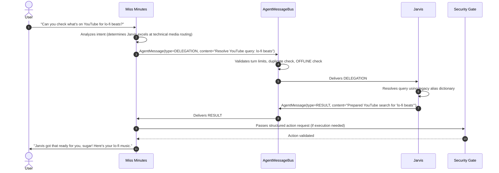

# Dual-Agent System Architecture: Miss Minutes & Jarvis

**Specification Status:** Phase 3 Architecture Foundation  
**System Model:** Collaborative Peer Assistants with Distinct Roles  
**Target Platform:** Windows 10/11 Desktop

---

## 1. High-Level Concept

Miss Minutes evolves into a **dual-agent desktop assistant system** featuring two distinct, complementary AI companions who are close friends and trusted colleagues:

- **Miss Minutes (Primary Companion):** Front-of-house persona. Warm, playful, curious, expressive, and slightly mischievous. She greets the user, drives the desktop overlay, engages in casual conversation, and understands user intent.
- **Jarvis (Technical Specialist):** Back-of-house specialist. Calm, professional, confident, technically precise, protective, and equipped with dry, subtle wit. When a task involves deep calculation, system queries, or technical parsing, Miss Minutes delegates it to Jarvis.

```mermaid
graph TD
    User([User]) <-->|Voice / UI| MM[Miss Minutes Agent]
    
    subgraph Message_Bus ["Agent Message Bus (Bounded & Secured)"]
        MM <-->|Delegation / Chat / Result| MB[Message Router & Loop Guard]
        MB <-->|Delegation / Chat / Result| JA[Jarvis Agent (Legacy Adapter)]
    end

    subgraph Security_Gate ["Security Gate & Allowlist"]
        JA -->|Proposed Action Candidate| SG[Security Validator]
        MM -->|Proposed Action Candidate| SG
        SG -->|Blocked| BlockedLog[Audit Deny]
        SG -->|Verified Safe| Exec[Windows Safe Executor]
    end

    subgraph Context_Store ["Shared Bounded Context"]
        MM -.->|Read/Write Turn| SC[(Bounded Turn History)]
        JA -.->|Read/Write Turn| SC
    end
```

---

## 2. Agent Abstraction (`Agent` Base Interface)

Both personalities implement a unified abstract base class:

```python
class Agent(ABC):
    @property
    def agent_id(self) -> AgentId: ...
    
    @property
    def name(self) -> str: ...
    
    @property
    def gender(self) -> str: ...
    
    @property
    def personality_traits(self) -> List[str]: ...

    @abstractmethod
    def receive_message(self, message: AgentMessage, context: SharedBoundedContext) -> Optional[AgentMessage]:
        """Processes an incoming message and optionally returns a response."""
        ...

    @abstractmethod
    def can_handle(self, task_description: str) -> bool:
        """Determines if the agent specializes in the requested task."""
        ...
```

---

## 3. Delegation & Collaboration Flow

When the user asks for a complex or technical operation (e.g. web search resolution, market overview, system metrics), Miss Minutes determines that Jarvis is better suited and initiates a delegation:



---

## 4. Loop Prevention & Autonomous Guardrails

To prevent unbounded agent-to-agent conversational ping-pong loops:

1. **Max Turn Threshold:** Any conversation between agents is capped at **5 turns** maximum (default `max_turns=5`). When the limit is reached, the bus automatically marks the thread complete and disallows further automated replies.
2. **Conversation Timeouts:** Conversations expire after 30 seconds of inactivity.
3. **Duplicate Message Filtering:** Consecutive identical messages within the same conversation are rejected to prevent echoing.
4. **Cancellation Tokens:** The user or the UI can cancel an in-flight conversation immediately at any moment.

---

## 5. Security & State Invariants

1. **OFFLINE Master Cutoff:**
   - If Miss Minutes' authoritative FSM is in the `OFFLINE` state, the `AgentMessageBus` unconditionally **drops and rejects** all messages.
   - Zero agent-to-agent delegation or autonomous messaging occurs while `OFFLINE`.
2. **Zero Shell Authority:**
   - Neither Miss Minutes nor Jarvis possesses shell, PowerShell, CMD, or arbitrary process execution powers.
   - Jarvis output remains an *untrusted candidate* that must be evaluated by the independent Security Validator before any safe Windows API is called.
