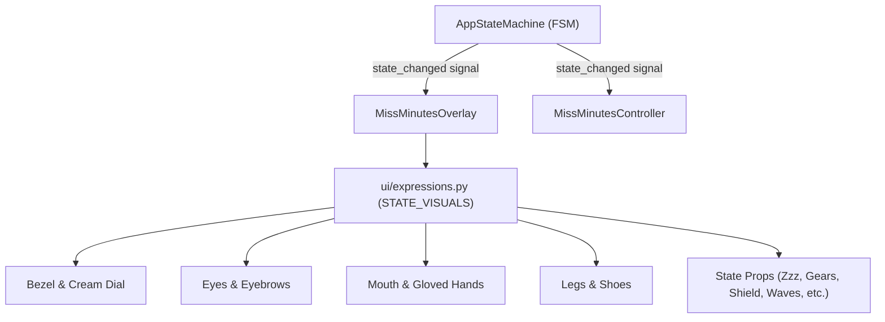

# Miss Minutes: Phase 2 Visual & UX Foundation Implementation Report

**Implementation Status:** Complete  
**Date:** 2026-10-23  
**Target Platform:** Windows 10/11 (64-bit)  
**Reference Document:** `Miss_Minutes_PRD.md` (Contract Baseline) & Attached *Miss Minutes — Expressions & States* Reference  

---

## 1. Executive Summary

Phase 2 transforms the Phase 1 desktop foundation into an expressive, living **Miss Minutes desktop assistant companion**. 

In strict alignment with the product vision and security rules:
- **100% Original Vector Character:** The character is procedurally drawn using Qt `QPainter` with zero copyrighted Marvel/Loki assets.
- **Authoritative State-Driven Visuals:** The 12-state FSM remains the single source of truth; the visual layer reacts strictly to FSM state signals.
- **Complete Visual Mapping for All 12 States:** All 12 states from the PRD and reference design (`OFFLINE`, `IDLE`, `WAKE_DETECTED`, `LISTENING`, `TRANSCRIBING`, `THINKING`, `VALIDATING`, `WORKING`, `SPEAKING`, `SUCCESS`, `ERROR`, `BLOCKED`) have full, distinct expressions, arms, legs/shoes, and prop indicators.
- **Lightweight Qt Animation:** Built with `QTimer`, deterministic frame intervals, natural blinking, breathing glows, gear rotation, and soundwave pulses. Includes reduced-motion accessibility.
- **Desktop Position Persistence & Safety:** Window positions are automatically saved to `~/.miss_minutes/config.json` and safely clamped to visible monitor workspaces on startup.
- **Refined Control Panel:** Features a mini Miss Minutes avatar badge, status indicator, prominent power button, and an interactive 10-state visual simulator grid.
- **Zero Premature Features:** No AI APIs, no microphone streaming, no wake word, and no operating system automation were introduced.

---

## 2. Visual Architecture & State-to-Expression Mapping

All visual definitions are decoupled into a dedicated mapping layer in `ui/expressions.py`.



### 2.1 Complete 12-State Expression Specification

| State | Bezel / Aura | Eyes & Eyebrows | Mouth | Arms & Gloved Hands | Legs & Stance | State Prop / Effect | Meaning / Activity |
| :--- | :--- | :--- | :--- | :--- | :--- | :--- | :--- |
| **`OFFLINE`** | Muted bronze, no glow | Sleeping curved eyes (`⌒ ⌒`), relaxed lashes | Resting horizontal slit | Resting at sides | Sitting down on floor | Floating `"Z z z"` above head | Assistant is completely disabled. |
| **`IDLE`** | Amber/gold, breathing glow | Big cheerful open eyes, dual sparkle highlights | Warm open smile | Left on hip, right waving high | Standing confident | Golden halo aura | Assistant is ON and waiting. |
| **`WAKE_DETECTED`** | Bright yellow-gold | Alert wide pupils, raised eyebrows | Surprised small `'o'` mouth | Right hand raised near ear | Alert stance | Sparkle burst rays near head | "Hey Minutes? Yes? I'm listening..." |
| **`LISTENING`** | Sky-blue / amber | Peaceful attentive closed eyes (`⌒ ⌒`) | Gentle listening smile | Right hand cupped to ear | Standing attentive | Cyan radiating soundwaves `) ) )` | Listening to user voice. |
| **`TRANSCRIBING`** | Violet / purple | Focused downward gaze | Small focused line | Both hands holding tablet | Standing | Glowing holographic tablet with code lines | Converting speech to text. |
| **`THINKING`** | Warm orange | Thoughtful upward-right gaze, one raised brow | Pursed curious lips | Finger on chin (thinker pose) | Relaxed stance | Floating thought cloud bubble | "Let me think..." |
| **`VALIDATING`** | Cyan / emerald | One eye magnified behind lens, one focused | Reassuring smirk | Holding magnifying glass | Standing | Magnifying glass with security scanline | Checking if action is safe. |
| **`WORKING`** | Vivid amber | Energetic wide bright pupils | Wide enthusiastic open smile | Pumping running arms | Stride running stance | Two spinning golden gears orbiting | Working on approved action. |
| **`SPEAKING`** | Warm magenta/gold | Lively expressive eyes | Animated talking mouth | Open welcoming palms | Standing | Radiating magenta soundwaves | Miss Minutes is responding. |
| **`SUCCESS`** | Emerald green & gold | Winking left eye, sparkling right eye | Beaming celebratory grin | Double thumbs up | Cheering jump stance | Golden star sparkles | Done! Operation succeeded. |
| **`ERROR`** | Coral / red | Sad droopy teardrop eyes, slanted sad brows | Sad wavy frown | Drooping sad arms | Slumped stance | Red dizzy scribble tangle above head | Oops! Something went wrong. |
| **`BLOCKED`** | Resolute crimson | Stern determined gaze, V-angled brows | Firm protective line | Left on hip, right in STOP palm | Firm stance | Red security prohibition shield icon | Action restricted for your safety. |

---

## 3. Animation Framework & Performance

- **Lightweight Timer (`QTimer`):** Operates at ~25 FPS when active and ~10 FPS when OFFLINE.
- **Natural Eye Blinking:** Periodically triggers a brief 150ms eye closure every ~3.5 seconds during `IDLE` and `WORKING` states to make the character feel alive.
- **Deterministic Procedural Loops:**
  - Gear rotation in `WORKING` is calculated via trigonometric angle offsets (`math.degrees(self._anim_phase * 3)`).
  - Soundwave pulsing in `LISTENING` and `SPEAKING` uses alpha-decay concentric arcs.
  - Floating `"Z z z"` bobbing uses a smooth low-frequency sine wave.
- **Reduced-Motion Mode:** Accessible via the control panel and right-click context menu. Instantly halts continuous timers and locks to static expressive poses.
- **Clean Teardown:** All timers are unconditionally stopped on `shutdown()` and `aboutToQuit`, preventing hanging worker threads or background CPU utilization.

---

## 4. Position Persistence & Multi-Monitor Safety

Window positions and UI preferences are safely stored in:
```text
~/.miss_minutes/config.json
```

### 4.1 Schema
```json
{
  "overlay": {
    "x": 1089,
    "y": 60
  },
  "controller": {
    "x": 759,
    "y": 60
  },
  "reduced_motion": false
}
```

### 4.2 Safety Guarantees
1. **Crash-Proof Loading:** If the file is missing, empty, or contains corrupted JSON, `load_window_positions()` catches all parsing exceptions and returns safe default coordinates.
2. **Screen Boundary Clamping:** `clamp_to_screen_boundaries()` enumerates all connected monitors via `QGuiApplication.screens()`. If saved coordinates lie outside all monitors (e.g. after disconnecting an external monitor), the coordinates are automatically clamped to the primary screen workspace.
3. **No Sensitive Data:** Never persists API keys, credentials, audio buffers, or conversational text.

---

## 5. Control Panel Polish & Testing Controls

The control panel was updated in `ui/controller.py`:
- **Header:** Features a mini animated Miss Minutes avatar badge, bold title, and dynamic status dot (`● Assistant is ON` / `● Assistant is OFF`).
- **Power Button:** Prominent manual toggle switch (`TURN ON ASSISTANT` / `TURN OFF ASSISTANT`).
- **Status Card:** Real-time state badge styled according to state colors, accompanied by human-readable explanations.
- **10-State Visual Simulator Grid:** Includes `[ Wake ]`, `[ Listen ]`, `[ Transcribe ]`, `[ Think ]`, `[ Validate ]`, `[ Work ]`, `[ Speak ]`, `[ Success ]`, `[ Error ]`, `[ Blocked ]` for interactive QA. Buttons are safely disabled when `OFFLINE`.
- **Bottom Bar:** Motion toggle (`Motion: Normal` / `Motion: Reduced`) and Clean Close button.

---

## 6. Verification & Test Suite Results

### 6.1 Automated Pytest Suite
Command:
```powershell
python -m pytest tests/
```
Output:
```text
============================= test session starts =============================
platform win32 -- Python 3.14.3, pytest-9.1.1, pluggy-1.7.0
PySide6 6.12.0 -- Qt runtime 6.12.0 -- Qt compiled 6.12.0
rootdir: C:\Users\SHANMUKHESWAR\OneDrive\Desktop\Miss_minutes\Jarvis
plugins: anyio-4.12.1, qt-4.5.0
collected 16 items

tests\test_lifecycle.py .......                                          [ 43%]
tests\test_settings.py ...                                               [ 62%]
tests\test_visuals_and_persistence.py ......                             [100%]

============================= 16 passed in 0.90s ==============================
```

### 6.2 Programmatic State Cycling & Rendering Test
Command:
```powershell
python -c "from app.main import MissMinutesApp; from ui.state_machine import AssistantState; from PySide6.QtCore import QTimer; from PySide6.QtWidgets import QApplication; import sys; app = QApplication(sys.argv); m = MissMinutesApp(qapp=app); m.show(); print('Initial state:', m.state_machine.current_state.value); m.state_machine.turn_on(); print('After turn_on:', m.state_machine.current_state.value); [m.state_machine.transition_to(s) for s in [AssistantState.WAKE_DETECTED, AssistantState.LISTENING, AssistantState.TRANSCRIBING, AssistantState.THINKING, AssistantState.VALIDATING, AssistantState.WORKING, AssistantState.SPEAKING, AssistantState.SUCCESS, AssistantState.ERROR, AssistantState.BLOCKED]]; print('Successfully cycled all states! Final state:', m.state_machine.current_state.value); m.state_machine.turn_off(); print('After turn_off:', m.state_machine.current_state.value); QTimer.singleShot(200, m.shutdown); sys.exit(app.exec())"
```
Output:
```text
Initial state: OFFLINE
After turn_on: IDLE
Successfully cycled all states! Final state: BLOCKED
After turn_off: OFFLINE
```

---

## 7. Audit of Files

### 7.1 Files Created
- `config/persistence.py`: Window position persistence and screen clamping.
- `ui/expressions.py`: Complete token mapping and visual configurations for all 12 states.
- `tests/test_visuals_and_persistence.py`: Unit tests for visual states, persistence, and screen clamping.
- `docs/PHASE_2_IMPLEMENTATION.md`: This comprehensive implementation document.

### 7.2 Files Modified
- `ui/overlay.py`: Expanded character renderer with arms, legs, shoes, clock hands, and 12-state props.
- `ui/controller.py`: Refined control panel with mini avatar, status dot, and 10-state simulator grid.
- `ui/theme.py`: Theme styling for avatar badge and simulator buttons.
- `ui/__init__.py`: Exported new expression and visual tokens.
- `config/__init__.py`: Exported persistence functions.
- `app/main.py`: Connected position loading, boundary clamping, and motion toggles.
- `tests/test_lifecycle.py`: Updated dimension assertions to match Phase 2 overlay (150x170) and controller (310x330).

### 7.3 Files Intentionally Untouched
- `Miss_Minutes_PRD.md`
- `jarvis_actions.py`
- `jarvis_brain.py`
- `jarvis_voice.py`
- `jarvis_market.py`
- `jarvis_workplace.html`
- `install.bat`, `install.sh`, `INDEX.md`, `README.md`, `requirements.txt`
